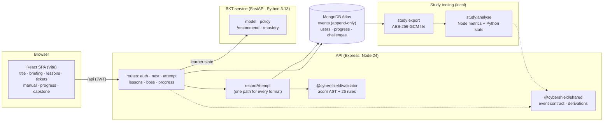

# Evidence pack

Facts and figures about the artefact, for writing the dissertation from. Each item
points at the file or commit it comes from, so anything cited can be checked. Figures
are as of **4 Oct 2026** (commit history to `3521c14`); rerun the commands to refresh
them before submission.

This is raw material, not prose. See [`plan.md`](plan.md) for where each piece goes.

---

## Artefact in numbers

| Measure | Value | Source |
|---|---|---|
| Challenges | 20: 7 patch, 6 spot-the-flaw (drills), 3 harden, 3 review, 1 capstone | `content/challenges/*.json` |
| Per skill (excl. capstone) | SQLi 7 (3 patch, 2 spot, 1 review, 1 harden); XSS 7 (3, 2, 1, 1); CSRF 5 (1, 2, 1, 1) | same |
| Tiers | 8 beginner, 9 intermediate, 3 advanced | same |
| Lessons | 3 (one per skill): theory, live demo, guided fix, 2-question check | `content/lessons.js` |
| Validation rules | 26 AST rules, each tagged security or functional | `packages/validator/src/rules.js` |
| Event types | 17 in the contract; 15 emitted (`challenge.abandoned`, `mastery.updated` are derivable and deliberately not stored) | `packages/shared/src/events.js`, `docs/telemetry-model.md` |
| Badges | 6 | `content/badges.js` |
| Source lines (excl. tests) | web 5,509; API 2,304; validator 1,238; shared 536; ML 1,086 (BKT 604, analysis 318, service 164); study scripts 1,078; content 2,040 | `wc -l` |
| Test lines | API 2,516; validator 541; ML 742 | same |
| Automated tests | **516**: API 196, validator 208, web 10, integration (real MongoDB) 17, Python 85; plus a 31-check end-to-end smoke test | `npm test --workspaces`, `npm run test:integration`, `npm run ml:test`, `npm run smoke` |
| Commits | 34, 25 Aug – 4 Oct 2026 | `git log` |

## Timeline (from the commit history)

This covers **implementation only** (25 Aug onwards). Your Gantt chart must also show
the earlier milestones from your own records (allocation Feb, ethics Mar, proposal
Apr, approval) and planned vs actual.

| Date | Phase | Commits (short) |
|---|---|---|
| 25 Aug | Foundations: telemetry model, game design, AST validator, API, JSDoc typing, CLI, BKT model + policy + evaluation, recommendations, FastAPI service, integration + smoke tests, challenge screen, palettes, authentication | `5605aa3` … `cfdc5fa` (13) |
| 26 Aug | Character sheet + skill tree, XSS/CSRF content and rules, capstone, icons, one-command start, badges and reward | `28b5084` … `9f24939` (6) |
| 16 Sep | Spot-the-flaw drills, streaks, time to first action | `cb9ef61` |
| 29 Sep | Harden + review formats, content to 20 items, unified attempt recording, posture (consequence), title screen, Atlas connection, shift briefing, **lessons** | `304e0cf` … `28c2d97` (8) |
| 1 Oct | Encrypted study export, withdrawal tool, analysis pipeline | `f3c862a`, `70f03bc` |
| 2 Oct | WCAG 2.1 AA audit and fixes | `37f5207` |
| 4 Oct | Dissertation plan and evidence pack; capstone gate fix; risk register update | `ea6d256`, `3521c14`, `237d8ef` |

The history is a sequence of small, working increments, and 17 of the 34 commit
messages record the test results at that point. That is the honest basis for
describing the approach as **iterative and incremental**. Whether it was "Agile" depends on whether you also kept
a backlog and held reviews, which only you can say.

## Architecture

**Design points worth a diagram or a paragraph each**

- **Append-only event log as the source of truth.** Everything else (progress, streaks,
  follow-through, posture, mastery) is derived from it. Ordering is by a per-subject
  sequence number, not timestamps. *(`telemetry-model.md`, `apps/api/src/telemetry.js`)*
- **Two suites in tension.** Every verdict has a security suite (the attack must fail)
  and a functional suite (the feature must still work). A fix that closes the hole by
  breaking the feature fails. Content tests require every wrong answer to fail for a
  *different* reason. *(`game-design.md` §2, `packages/validator/test/content.test.js`)*
- **The model decides; the API enforces.** The BKT service picks the next item and
  says when the capstone is open; the API gates the capstone and the first ticket of
  each skill (behind its lesson) server-side, failing closed.
- **Pseudonymity by construction.** Subject ids are random, never derived from the
  handle; tokens never carry the handle; exports never include the users collection.

## Technology choices (and what was rejected)

| Choice | Over | Why (source) |
|---|---|---|
| React + Vite SPA | Server-rendered pages | Interactive editor, live demos and state per screen *(proposal: MERN)* |
| Hand-rolled two-route router | react-router | ~15 KB for a handful of flat routes; swapping later is cheap *(`apps/web/src/useRoute.jsx`)* |
| JSDoc + `checkJs` | TypeScript | Type checking with no build step; the checker found a null dereference that could silently lose a batch of events *(commit `cbf75d2`)* |
| Express + Mongoose + MongoDB | SQL database | Proposal's MERN stack; the event payloads vary by type *(proposal)* |
| Static AST validation (acorn) | Running submissions in Docker | Multi-tenant code execution was the highest delivery risk; for SQLi/XSS/CSRF a correct fix is structurally identifiable *(deviation D2)* |
| BKT | Deep knowledge tracing | DKT needs far more data than ~12 learners × ~7 observations per skill; BKT's parameters are interpretable and have literature priors *(D1, `services/ml/cybershield_bkt/model.py`)* |
| Python (FastAPI) for the model | Model in Node | Keeps the ML component in the language of its ecosystem; model core is standard-library only *(D1)* |
| Statistics written out (stdlib) | SciPy | Every reported number comes from a definition in the repository *(`services/ml/analysis/stats.py`)* |
| Exact Wilcoxon signed-rank | Paired t-test | n≈12 cannot show the differences are normal *(same)* |
| scrypt (N=2¹⁷) password hashing | bcrypt | Built into Node; memory-hard *(`apps/api/src/auth-logic.js`)* |
| Hand-drawn SVG art and icons | Downloaded asset packs | No licensing obligations; state never rests on colour alone *(commit `57cbce9`)* |
| node:test, pytest, mongodb-memory-server | Jest, mocks | Built-in runners; the database properties that matter (atomic sequence, unique index) only exist in a real mongod *(commit `ab418c4`)* |

## Candidate requirements

Derived from what was built, as a starting point. **Rewrite them in your own words**
and set the priorities yourself. Each has a way to verify it.

| ID | Requirement | Type | Verified by |
|---|---|---|---|
| FR1 | Learners register and sign in under a pseudonymous handle | F | `auth-routes.test.js` |
| FR2 | The system selects each learner's next challenge adaptively from their attempt history | F | `services/ml/tests/test_policy.py`; follow-through in the study |
| FR3 | Submissions are judged by security and functional suites, with an explanation per failed rule | F | `content.test.js` (every wrong answer fails for a distinct reason) |
| FR4 | Four challenge formats: patch, spot the flaw, harden, review | F | content tests; smoke test |
| FR5 | A lesson (theory, demo, guided fix, check) precedes the first ticket of each skill | F | `next-route.test.js` gate tests; `lessons-route.test.js` |
| FR6 | Progress is shown as mastery, XP, badges, streaks and the company's posture | F | `badges.test.js`, `streaks.test.js`, `posture.test.js` |
| FR7 | A capstone combining all three skills opens only when the model judges them mastered | F | gate tests in `next-route.test.js` |
| FR8 | Hints are available and are recorded, so hinted solves never count as unaided | F | `hints.test.js` |
| FR9 | Study data can be exported encrypted, withdrawn on request, and analysed reproducibly | F | `study-tools.test.js`, `study-analysis.test.js` |
| NFR1 | No learner code or handle is ever stored in the event log | NF | `integration.test.js` "no persisted event contains the submitted source" |
| NFR2 | Answers (rules, solutions, correct options) never reach the browser before submission | NF | `next-route.test.js`, `lessons-route.test.js` leak tests |
| NFR3 | WCAG 2.1 AA in both palettes and at 320px | NF | `docs/accessibility.md` |
| NFR4 | No reward depends on speed, so time-on-task measures engagement | NF | `attempt-logic.test.js` (D5) |
| NFR5 | The event sequence is gap-free and unique per learner under concurrency | NF | `integration.test.js` (25 concurrent appends) |
| NFR6 | The platform degrades honestly when the model is down (503, fail closed) | NF | `next-route.test.js` |

## Testing

| Suite | Tests | What it proves | Command |
|---|---|---|---|
| Validator: content | 195 | Every challenge: reference patch passes; vulnerable code fails; each wrong answer fails for a different reason; answers don't leak | `npm test -w @cybershield/validator` |
| Validator: lessons | 13 | Guided fixes start failing and end passing; worked examples are not any ticket's answer; checks are well-formed | same |
| API unit | 196 | Attempt logic, XP rules, auth, routes, gates, hints, badges, streaks, posture, study tooling, analysis | `npm test -w @cybershield/api` |
| Web | 10 | The briefing never claims anything the record doesn't show | `npm test -w @cybershield/web` |
| Integration | 17 | Real MongoDB: atomic sequences, unique index, concurrent appends, privacy on disk, capstone completion | `npm run test:integration` |
| Python | 85 | BKT model, policy (simulated learners), evaluation metrics, statistics checked against hand-worked values | `npm run ml:test` |
| Smoke (end to end) | 31 checks | Fresh database → recommendation → lesson gate → full lesson → bad patch → good patch → log integrity → mastery moves | `npm run smoke` |
| Accessibility | 11 findings fixed | axe-core, calculated contrast, keyboard walkthrough | `docs/accessibility.md` |

## Defects found and fixed

Each was found by testing, type checking, or running the system, and is now covered by
a test or check. Useful for §4.3 ("What bugs did you find and fix?") and §4.7.

| # | Defect | How found | Consequence if shipped | Commit |
|---|---|---|---|---|
| 1 | `/api/health` depended on the database | Probing the running app | Liveness probe failed exactly when needed | `b4723e5` |
| 2 | Auth ran after the DB middleware: unauthenticated requests got 500 and opened connections | Probing; regression caught again later by its test | Anonymous resource use; wrong status | `b4723e5`, `cfdc5fa` (R17) |
| 3 | Null dereference in sequence reservation under an upsert race | Type checker | A batch of events silently lost | `cbf75d2` |
| 4 | A test that could not fail (passed an argument the function ignored) | Type checker | The D5 guarantee was untested | `cbf75d2` |
| 5 | New learners were told "nothing left to serve" | Full-stack smoke test | Every new user stuck on an empty screen | `ab418c4` |
| 6 | Offline fixture validator failed a correct answer | Using the UI | Wrong verdict in offline mode | `5ebee5d` |
| 7 | Open-path prefix match would expose `/auth/me` and `/auth/logout` | Running it | Unauthenticated access to session routes | `cfdc5fa` |
| 8 | Skill-tree connectors detached when ResizeObserver was inert | Browser testing | Broken diagram in some browsers | `28b5084` |
| 9 | Mastery per skill always read zero (id-prefix assumption) | Browser testing | Wrong progress display | `28b5084` |
| 10 | Taint lost through a method receiver (`term.slice(0)`) | Content tests | An unsafe patch judged safe | `60e31fd` |
| 11 | Mongoose silently dropped the capstone's `stages` field | Running it | Capstone "not found" | `ac483dc` |
| 12 | Reward counter froze at "+0" in a background tab | Browser testing | Learner saw no reward | `9f24939` |
| 13 | Field notes showed SQLi mastery for every skill | Browser testing | Wrong feedback | `cb9ef61` |
| 14 | Harden item's two wrong answers failed identically | Content test | Feedback couldn't distinguish the mistakes | `304e0cf` |
| 15 | Every challenge showed sec-101's hints, and hints were never recorded | Code review + browser | **Hinted solves counted as unaided for BKT, XP and badges: corrupted study data** | `2ef8180` |
| 16 | Beating the capstone awarded nothing; every attempt recorded as the first | Code review | Badge unobtainable; wrong attempt counts | `2ef8180` |
| 17 | Capstone reachable before it was earned | Code review | Meaningless capstone data in the study | `2ef8180` |
| 18 | Code ligatures drew `!==` as one glyph | Browser testing | Learner can't see the characters to type | `f5afbc5` |
| 19 | Consequence panel never shown at zero posture | Browser testing | Feedback missing when failures are commonest | `f5afbc5` |
| 20 | Dev launcher sent the API to Vite's port | Running it | Silent fallback to fixture data | `fbddca2` |
| 21 | `npm run seed` never ran in a path containing a space | Connecting to Atlas | Empty database, no error | `9de083e` |
| 22 | Shift log gave a failed attempt the retry's XP | Unit test | False activity history | `fd86045` |
| 23 | Briefing named an arbitrary "weakest" skill on a tie | Browser testing | Invented fact presented to the learner | `fd86045` |
| 24 | Answering a check question dropped keyboard focus to the top of the page | Accessibility audit | Keyboard users lose their place | `37f5207` |
| 25 | Results not announced to screen readers; pass/fail shown only by shape | Accessibility audit | Screen-reader users get no feedback | `37f5207` |
| 26 | The model gated the capstone on SQLi alone and could serve it as an ordinary ticket | Checking the risk register's claims against the code | Skill tree showed it open while the API refused it; late in a session, a screen that cannot render it | `3521c14` |
| 27 | Signing in kept the previous page, so a new user could land straight in a lesson; nothing explained the platform first | **User testing** (a friend's session, 19 Oct) | An overwhelming first experience | *this commit* |

## Code excerpts worth showing

Short, and each illustrating a *decision* (the template warns against pasting large blocks):

| Excerpt | File | Shows |
|---|---|---|
| `countsForBkt` (≈3 lines) | `packages/shared/src/events.js` | BKT trains on unaided first attempts only |
| `deriveFollowed` | same | Derived, not stored (D6) |
| A rule pair, e.g. `sql.app-can-read` / `sql.app-can-write` | `packages/validator/src/rules.js` | Security vs functional suites |
| `predict_correct` / `update` | `services/ml/cybershield_bkt/model.py` | The BKT model itself |
| `lessonDue` | `apps/api/src/routes/next.js` | Server-side gating |
| `combineStages` | `apps/api/src/attempt-logic.js` | Capstone verdict, never a BKT observation |
| `wilcoxon_signed_rank` (exact distribution) | `services/ml/analysis/stats.py` | Exact test for small n |

## Screenshots to take

Title screen · briefing (first shift, and with history) · lesson: theory, each demo,
guided fix with a failure, check · a patch ticket with a failed verdict and posture
consequence · spot, review and harden tickets · reward panel · progress (character
sheet, skill tree, commendations) · field manual · capstone (locked, partial, held) ·
both palettes for one screen. Use a throwaway local account (`npm run dev`), never a
participant's.

## Study data handling

| Stage | What happens | Where |
|---|---|---|
| Enrolment | Pseudonymous handle; in-person study code marks study accounts | `auth.js` |
| Collection | Append-only events against a random subject id; no source code, only a hash | `telemetry.js`, `attempt-logic.js` |
| Backup | `study:export`: study participants only; no handles or hashes; AES-256-GCM, scrypt-derived key; gap check | `scripts/study/export.mjs` |
| Withdrawal | `study:withdraw`: dry run first, then deletes account, events, progress, counter; id recorded so older backups are filtered | `scripts/study/withdraw.mjs` |
| Analysis | From the encrypted file only, never the live DB; withdrawn excluded again | `scripts/study/analyse.mjs` |
| Outcomes | Pre/post and SUS collected outside the platform; any participant code; pairing needs no link to telemetry | `README.md` "Running the study" |

## LO3 inventory (legal, ethical, social, professional)

| Issue | What was done | Evidence |
|---|---|---|
| Human participants | Ethics approval obtained before data collection | *your approval reference* |
| Consent and withdrawal | Withdrawal tool honours the protocol, including older backups | `withdraw.mjs` |
| GDPR / DPA 2018 | Pseudonymisation, data minimisation (no code, no handles in exports), encryption at rest for backups | telemetry-model "What is deliberately NOT recorded"; `export.mjs` |
| Computer Misuse Act 1990 | Defensive only: attacks are canned; learners never target real systems; demos are simulations that execute nothing | `game-design.md` §1, §1a |
| Security-sensitive content | Vulnerable snippets are synthetic and non-executable; repository private until submission | risk register R9 |
| Accessibility | WCAG 2.1 AA audit, 11 issues fixed | `accessibility.md` |
| Licensing | No third-party art; all icons and art drawn in-repo; OSS dependencies (MIT/BSD/Apache) | `content/assets/manifest.json`, `package.json` |
| Study validity as an ethical issue | No speed bonus; palette and sound pinned for participants; lessons required for everyone | D5; `usePalette.js`; game-design §1a |
| Professional practice | Tests before each increment; deviations raised with the supervisor in writing | deviations "Supervisor communication" |
| AI use | Declared; see below | |

## Scope and limitations (facts to draw on)

- Three vulnerability classes only (SQLi, XSS, CSRF); JavaScript/Express only.
- All tiers use static validation; no container-based execution (D2; supervisor reply pending).
- One capstone, not the two planned (game-design §8).
- Small sample (n≈12), single session: BKT parameters are not identifiable at this
  scale (the fitter says so); the evaluation reports the literature priors as primary.
- No control group by design (D3); comparison with other platforms is qualitative.
- `challenge.abandoned` and `mastery.updated` are not recorded; abandonment is not yet analysed.
- `session.ended` only on sign-out; active time includes idle time within a session.
- Lessons add ~12 minutes; time to first action includes the first lesson.
- No real screen-reader test yet (`accessibility.md` "Limitations").
- Not deployed publicly; designed to run locally for supervised sessions.

## AI use

Facts to report honestly in §3.1 and §3.9, and to declare on the title page:

- The implementation was developed in collaboration with an AI coding assistant
  (Claude Code, Anthropic; model Claude Opus 5.5), which wrote code, tests and project
  documentation in response to your direction. Commits carry a `Co-Authored-By` line
  recording this.
- Your role, in your own words: decisions on scope, design direction and research
  design (e.g. the palette and UI choices you made when asked; the lesson format;
  everyone-sees-the-briefing; the study design); review and acceptance of each
  increment; running and verifying it.
- How correctness was checked independently of the assistant: 516 automated tests,
  type checking, end-to-end smoke tests, browser verification, an accessibility audit.

APA 7 format for citing a generative AI tool (confirm against university guidance):

> Anthropic. (2026). *Claude Code* (Claude Opus 5.5) [Large language model]. https://claude.com/claude-code
